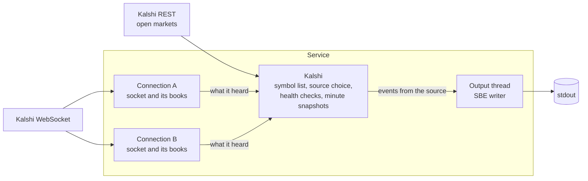

# Kalshi order book feed

A service that follows every regular market on [Kalshi](https://kalshi.com),
keeps an order book for each, and writes the books to stdout as SBE messages:
every change as it happens, and a full snapshot of every book once a minute.

It is a solution to the Voluntas engineering challenge. The template's own
notes are kept [at the end](#notes-from-the-challenge-template).

## What is covered

| Part of the challenge | State |
|---|---|
| Base: connect, follow all live symbols, keep a book per symbol, track symbols coming and going, write deltas and a snapshot every minute, close cleanly on SIGINT | Done |
| Extension 1: redundant WebSockets, with a snapshot when the source changes | Done |
| Extension 2: per-symbol activity monitoring and periodic reconnects | Not implemented |

## Running it

You need a Kalshi API key: a key id and the private key file that goes with it.

```bash
export KALSHI_API_KEY_ID=your-key-id
export KALSHI_PRIVATE_KEY_PATH=/path/to/key.pem
cargo run --release > out.bin
```

Data goes to stdout and the log goes to stderr, so the redirect captures only
data. Ctrl-C closes the WebSockets, writes what is still in memory, and exits.

Every setting is a flag and an environment variable. `--help` lists them.

| Flag | Variable | Default | Meaning |
|---|---|---|---|
| `--env` | `KALSHI_ENV` | `demo` | `demo` or `prod` |
| `--api-key-id` | `KALSHI_API_KEY_ID` | required | The id of the API key |
| `--private-key-path` | `KALSHI_PRIVATE_KEY_PATH` | required | The key's PEM file |
| `--series-ticker` | `KALSHI_SERIES_TICKER` | every market | Follow one series, e.g. `KXBTCD` |
| `--connections` | `KALSHI_CONNECTIONS` | 2 | WebSockets per group: one source, the rest standbys |
| `--groups` | `KALSHI_GROUPS` | 1 | Groups the symbols are divided into, each with its own connections |
| `--snapshot-window` | `KALSHI_SNAPSHOT_WINDOW` | 5000 | Books a connection may be waiting on while it loads |
| `--status-seconds` | `KALSHI_STATUS_SECONDS` | 5 | Seconds between status lines; 0 for none |

`RUST_LOG=warn` hides the status lines and shows only problems.

### Trying a failover

`SIGUSR1` makes the service drop its source connection, as a network failure
would, so the handover can be watched on demand:

```bash
pkill -e -USR1 -f target/release/engineering-challenge
```

## What it writes

Two message types from the challenge's schema, written with the provided
`AlignedSbeWriter`:

- **`Snapshot`**: one symbol's whole book. Written when a book is first
  loaded, when it had to be fetched again, for every book once a minute, and
  for every book when the source connection changes.
- **`PriceLevelUpdate`**: one price level now holds this quantity. Zero means
  the level is gone.

Prices and quantities are integers in millionths: `400000` is $0.40 and
`20000000` is 20 contracts. Both sides are in YES prices. Kalshi quotes NO
bids separately; a NO bid at $0.58 is written as a YES ask at $0.42.

To check a file, `inspect_output` rebuilds every book from the file alone and
compares each later snapshot with what it rebuilt:

```bash
cargo run --release --example inspect_output -- out.bin
```

## How it works



### One rule for staying in sync

The symbol list and every order book are the same kind of thing: a full
snapshot, then a stream of changes. [`Synced`](src/kalshi/synced.rs)
implements that once. Until a snapshot has loaded, changes are held; loading
one replays the held changes that are newer; after that, changes apply as
they arrive. Anything that casts doubt on the state (a missed message, a
reconnect) sends it back to waiting for a snapshot.

- For the **symbol list**, the snapshot is the list of open markets from REST
  and the changes are `market_lifecycle_v2` messages.
- For each **book**, both arrive on the `orderbook_delta` channel.

### The symbol list

[`SymbolList`](src/kalshi/symbols.rs) is plain logic with no I/O.

- A market becomes a symbol when it is activated and stops being one when it
  is paused, determined or settled.
- Kalshi sends no message when a market reaches its close time, so close
  times are kept in a sorted index and a timer removes each market on time.
- Multivariate (MVE) markets are left out by asking REST to exclude them.
  Kalshi has a separate lifecycle channel for them, which is not subscribed
  to.
- The list is fetched again every five minutes as a cross-check, and whenever
  lifecycle messages may have been missed.

### A connection

A [`Connection`](src/kalshi/connection.rs) is one WebSocket and the books
built from it. It:

- checks the sequence number of every message, acknowledgements included;
- on a gap, distrusts all of its books and asks for them again;
- asks for books only as fast as snapshots come back, so that Kalshi never
  owes it more than `--snapshot-window` of them;
- reconnects when the socket is lost, after 0.5 s at first and never more
  than 5 s;
- reports what it hears to its owner, and whether its books can be trusted.

### Redundancy

Each group of symbols is followed by several connections at once. One is the
**source**: only its changes are written. The rest are **standbys**, kept
fully loaded.

When the source is lost, misses a message, or is cut by a health check, a
standby that is in sync becomes the source. Its books may differ slightly
from the old source's, so every one of them is written as a snapshot before
its changes continue. If no standby is ready, the source stays, reloads, and
writes each book's new snapshot as it arrives.

A connection counts as in sync once it has books and every book it was asked
to follow while catching up has loaded.

Symbols can be divided into **groups**, each with its own source and
standbys, to spread the load over more sockets. A market's group is a hash of
its event ticker, so the markets of one event stay together and a market
never changes group.

### Health checks

A socket can fail without closing. Once a second, the connections of each
group are compared:

| Failure | How it is noticed | What happens |
|---|---|---|
| Dead socket | Nothing for 25 s, not even Kalshi's 10 s ping | Reconnect |
| Quiet subscription | Nothing for 3 s while another connection heard a change | Cut and reconnect |
| Silent, nothing to compare with | Nothing for 100 times the usual gap between changes, and at least 30 s | Reconnect, one connection at a time |
| Lagging | Messages 500 ms more delayed than the fastest connection's, three checks running | Cut and reconnect; the fastest takes over first if needed |

Delay is always judged between connections. Measured against the local clock
alone, a delay cannot be told from a clock that is off.

### Output and shutdown

Writing blocks, so [`Output`](src/output.rs) runs on its own thread and
receives events over a channel. On SIGINT the service sends each WebSocket a
close frame, waits briefly for the reply, then closes the channel; the writer
finishes what is queued and writes its last chunk.

### One task

Everything except the writer runs in a single task: one loop that waits on
the sockets, the REST fetch and a few timers. Nothing is shared between
threads, so there are no locks, and events reach the output in the order they
were handled.

## Decisions

- **Source and standby, not a merged stream.** The brief says to emit a
  snapshot when the source changes, because two sockets can hold different
  books. Merging two streams message by message would need them to agree.
- **A snapshot on every doubt.** Whenever a book might be wrong, the answer
  is a new snapshot, never a guess at what was missed.
- **Integers for prices and quantities.** Kalshi sends decimals as text; they
  are parsed exactly into millionths and never pass through floating point.
- **Paced subscribing.** A new connection has hundreds of thousands of books
  to ask for. It asks for a few thousand, and for more as they arrive.
- **Short waits everywhere.** While every connection of a group is down, each
  second of waiting is a second without data, so no retry waits over 5 s.
- **Libraries for the plumbing.** `tracing` for logs, `clap` for settings,
  `backon` for retries, `rust_decimal` for parsing, `wiremock` in tests. The
  feed logic itself is written here.

## Testing

```bash
cargo test
```

- **Unit tests** for the book, the symbol list, the sync rule and parsing.
- **A mock Kalshi** on localhost (a WebSocket server and a REST server)
  drives the whole service through loading, lost connections, missed
  messages, each health check, failover, groups and paced subscribing.
- **A test of the real binary**: it is started against the mock, sent SIGINT,
  and its stdout is read back with the challenge's reader.
- **A load test** with 230,000 markets on two connections:

```bash
cargo test --release at_full_scale -- --ignored --nocapture
```

Against Kalshi's demo environment, during development:

- All 229,353 open markets loaded on two connections in about 15 seconds
  each, then about 5,000 messages a second per connection.
- Every once-a-minute round of snapshots equalled the books rebuilt from the
  preceding changes, checked with `inspect_output`.
- Cutting the source on one series handed over to the standby, and the
  snapshots written at the handover matched the rebuilt books.
- Kalshi ending a subscription and closing the socket by itself was
  recovered from in a few seconds.

## Known limits

- **Extension 2 is not implemented.**
- **Not run against production.** All live runs used the demo environment,
  whose traffic is lighter and less steady.
- **Some paths have only run against the mock:** recovery from a missed
  message, each health check firing, and failover with every market loaded.
  The health thresholds are first estimates.
- **MVEs on the lifecycle channel.** Kalshi's documentation gives MVE
  markets their own lifecycle channel, but does not say that the regular one
  never mentions them. That has not been checked.
- **A crash of the whole process is not covered.** Redundancy is between
  sockets in one process.
- **Output is buffered in 64 MiB chunks,** as the provided writer works. Data
  reaches stdout when a chunk fills or at shutdown, and a process that is
  killed outright loses the chunk in memory.
- **Duplicate snapshots at startup.** Whichever connection finishes loading
  first becomes the source and writes every book, including those the other
  had already written.
- **In the provided helpers, left as they are:** the writer cannot be used
  again after a failed flush, and the reader stops without an error at a
  truncated final chunk.

## Layout

| Path | What it holds |
|---|---|
| [`src/main.rs`](src/main.rs) | Signals, wiring, shutdown |
| [`src/kalshi/mod.rs`](src/kalshi/mod.rs) | `Kalshi`: the symbol list's owner, source choice, health checks, minute snapshots, REST |
| [`src/kalshi/connection.rs`](src/kalshi/connection.rs) | `Connection`: one socket and its books |
| [`src/kalshi/synced.rs`](src/kalshi/synced.rs) | The snapshot-plus-changes rule |
| [`src/kalshi/symbols.rs`](src/kalshi/symbols.rs) | The symbol list |
| [`src/kalshi/book.rs`](src/kalshi/book.rs) | One order book |
| [`src/kalshi/wire.rs`](src/kalshi/wire.rs) | Parsing Kalshi's messages |
| [`src/output.rs`](src/output.rs) | Events to SBE messages |
| [`src/logging.rs`](src/logging.rs) | Log setup |
| [`examples/inspect_output.rs`](examples/inspect_output.rs) | Checks an output file against itself |
| [`examples/kalshi_symbols.rs`](examples/kalshi_symbols.rs) | Prints every event as text |
| `src/util/`, `sbe_schemas/` | The challenge's SBE helpers, unchanged |

## Notes from the challenge template

This repo uses the [FIX SBE standard](https://fixtrading.org/packages/simple-binary-encoding-technical-specification-v2-rc2/)
for writing binary messages. The rust code abstracts this away for you, and you can simply use the helpers, as demonstrated in `main.rs`.

FIX SBE is defined in XML, which I find extremely cumbersome to edit, especially
when updating schemas frequently. To solve this, I have also introduced some
helper code that takes our own custom YAML format, and turns it into FIX SBE
XML, which in turn is used to generate rust code to encode and decode the
messages. **You don't need to edit any of these files**. This explanation is
simply to help you understand the origins of the various files in this repo.

If you're curious to see the YAML schema, take a look at [challenge_orderbook.yaml](https://github.com/voluntas-io/engineering-challenge/blob/main/sbe_schemas/engineering_challenge/challenge_orderbook.yaml).
We also use a custom timestamp field, so that the Rust struct can use
`chrono::DateTime` in the generated struct, and in SBE schema, it is a uint64
representing the timestamp as the number of microseconds since unix epoch.
